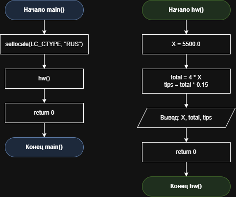

# Домашнее задание к работе 2

## Условие задачи
Четыре человека пообедали в ресторане. Официант подал им счет на Х руб. каждому.
Они решают оставить официанту чаевые в размере 15% от счета. Составьте программу,
которая выведет на экран сумму чаевых, которую получил официант.

## 1. Алгоритм и блок-схема

### **Алгоритм**
1. **Начало**
2. Подключить необходимые библиотеки:
   - `<locale.h>` - для работы с локалью (поддержка русского языка).
   - `<stdio.h>` - для ввода/вывода данных (printf).
3. Определить функцию `hw()` для расчёта суммы чаевых:
   - Объявить переменные типа double: X (счёт на одного человека), total (общий счёт на 4 человек), tips (общая сумма чаевых).
4. Задать исходное значение счёта на одного человека:
   - X = 5500.00
5. Вычислить общий счёт на четверых человек:
   - total = 4 * X
6. Рассчитать размер чаевых официанту (15 % от общей суммы счёта):
   - tips = total * 0.15
7. Вывести на экран результат расчёта с форматированием до двух знаков после запятой:
   - Использовать `printf` для отображения счёта X, общего счёта total и суммы чаевых tips.
8. Вернуть значение 0 из функции `hw()` (успешное завершение работы функции).
9. Определить функцию `main()` - точку входа в программу:
   - Установить локаль для корректного отображения кириллицы: `setlocale(LC_CTYPE, "RUS")`.
   - Вызвать функцию `hw()` для выполнения расчёта и вывода результата.
10. **Конец**

### Блок-схема
 

[https://github.com/stzraw/lab-2-VSTU-HW/blob/main/lab_2_schema.png](https://github.com/stzraw/lab-2-VSTU-HW/blob/main/lab_2_schema.pravki.png)

## 2. Реализация программы

#include <locale.h>
#include <stdio.h>

int hw();

int main()
{
    setlocale(LC_CTYPE, "RUS");
    hw();
    return 0;
}

int hw()
{
    double X;
    double total;
    double tips;
	
    X = 5500.0;

    total = 4 * X;
    tips = total * 0.15;

    printf("Счёт на одного человека: %.2f руб.\n", X);
    printf("Общий счёт на 4 человек: %.2f руб.\n", total);
    printf("Чаевые официанту (15%%): %.2f руб.\n", tips);
    return 0;
}

## 3. Результаты работы программы

Счёт на одного человека: 5500.00 руб.
Общий счёт на 4 человек: 22000.00 руб.
Чаевые официанту (15%): 3300.00 руб.

## 4. Информация о разработчике

Быханов Александр Андреевич бИД - 262 2пг

