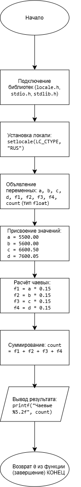

# Домашнее задание к работе 2

## Условие задачи
Четыре человека пообедали в ресторане. Официант подал им счет на Х руб. каждому.
Они решают оставить официанту чаевые в размере 15% от счета. Составьте программу,
которая выведет на экран сумму чаевых, которую получил официант.

## 1. Алгоритм и блок-схема

### Алгоритм
1. **Начало**
2. Подключить необходимые библиотеки:
   - <locale.h> - для работы с локалью (поддержка русского языка).
   - <stdio.h> - для ввода/вывода данных (printf).
   - <stdlib.h> - стандартные функции библиотеки (в данном коде напрямую не используются, но подключены).
3. Определить функцию `hw()` для расчёта суммы чаевых:
   - Объявить переменные типа float: a, b, c, d (суммы заказов), f1, f2, f3, f4 (чаевые по каждому заказу), count (общая сумма чаевых).
4. Задать исходные значения сумм заказов:
   - a = 5500.00
   - b = 5600.00
   - c = 6600.50
   - d = 7600.05
5. Рассчитать размер чаевых для каждого заказа (15 % от суммы):
   - f1 = a * 0.15
   - f2 = b * 0.15
   - f3 = c * 0.15
   - f4 = d * 0.15
6. Вычислить общую сумму чаевых:
   - count = f1 + f2 + f3 + f4
7. Вывести на экран результат расчёта с форматированием до двух знаков после запятой:
   - Использовать `printf("Чаевые %5.2f", count)` для отображения общей суммы чаевых.
8. Вернуть значение 0 из функции hw() (успешное завершение работы функции).
9. Определить функцию main() - точку входа в программу:
   - Установить локаль для корректного отображения кириллицы: setlocale(LC_CTYPE, "RUS").
   - Вызвать функцию hw() для выполнения расчёта и вывода результата.
10. **Конец**

### Блок-схема
 

https://github.com/stzraw/lab-2-VSTU-HW/blob/main/lab_2_schema.png

## 2. Реализация программы

#include <locale.h>
#include <stdio.h>
#include <stdlib.h>

int hw()
{
	float a, b, c, d, f1, f2, f3,f4,count;
	a = 5500.00;
	b = 5600.00;
	c = 6600.50;
	d = 7600.05;
	f1 = a*0.15;
	f2 = b*0.15;
	f3 = c*0.15;
	f4 = d*0.15;
	count = f1 + f2 + f3 + f4;
	printf("Чаевые %5.2f", count);
	return 0;
}

int main()
{
	setlocale(LC_CTYPE, "RUS");
	hw();
}

## 3. Результаты работы программы

Чаевые 3795.08

## 4. Информация о разработчике

Быханов Александр Андреевич бИД - 262 2пг

